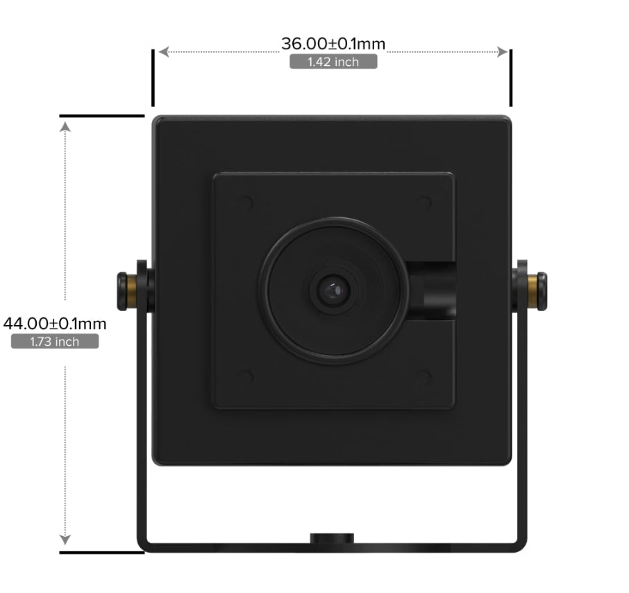
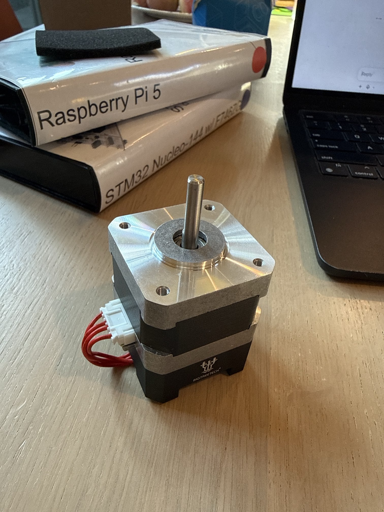
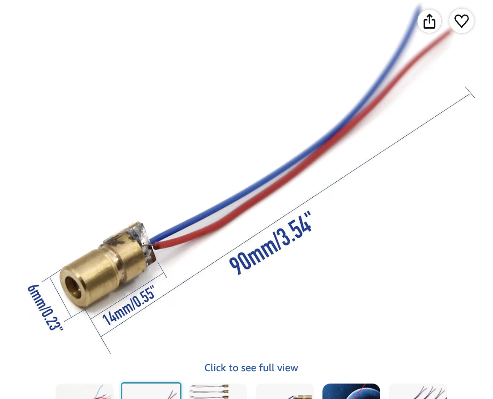
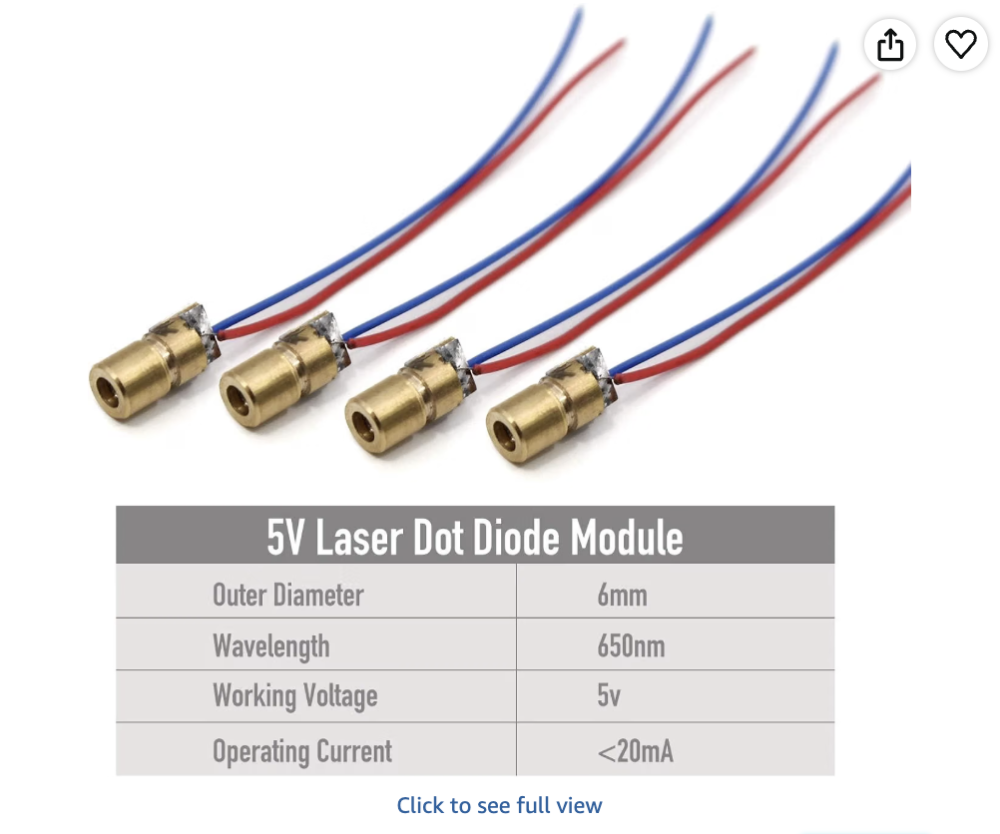

# Parts and specs (for CAD)

Every bought part the turret uses, with the sizes the CAD needs.
All sizes in mm. **MEASURE** = not in any datasheet; measure the real part with
calipers before printing. Last updated Nov 25, 2026.

## Motion

| Part | Qty | Key sizes | Source | Status |
|---|---|---|---|---|
| BIGTREETECH S42C V1.1 + metal cover + NEMA 17 motor (Amazon B09LHFS2HF) | 2 | Driver board 40 x 40, M3 holes on 31 x 31 square. Board stack ~17 thick (pins 3.4 below the board, OLED top 13.5 above). Side 6-pin plug: VM NC GND EN STEP DIR. NEMA 17 face 42.3 x 42.3, shaft Ø5. | [BTT S42C STEP + manual](https://github.com/bigtreetech/BIGTREETECH-Stepper-Motor-Driver/tree/master/BIGTREETECH%20S42C%20V1.0) | Measured by Aru (ruler, Nov 25): face 43 x 43, body incl. S42C cover 50 tall, shaft 25 (total 75). No full-motor CAD from BTT (their STEP is the board only), so model it as a block. Recheck with calipers. |
| Lazy susan bearing, Triangle 4C (Amazon B071LPSVTH) | 1 | 4" (101.6) square, 5/16" (7.9) thick, 1/4" balls | Amazon listing | Hole spots: mark and drill at assembly |
| 608-2RS bearing | 1 | 8 ID x 22 OD x 7 wide | Standard size | To order |
| 5 mm flange shaft hub | 2 | 5 mm bore | | To order, check hole pattern |

## Vision and laser

| Part | Qty | Key sizes | Source | Status |
|---|---|---|---|---|
| Arducam 1080p HDR autofocus USB camera, metal case (Amazon B0FX47YSJQ) | 1 | Lens 78° (D). USB 2.0 UVC. 1 m USB to JST cable. | Arducam front drawing (below). No CAD file. | Case front 36 x 36 (44 tall with the U bracket; bracket removed for the head). Raised square 24 x 24 x 2, lens ring Ø14 x 0.75 on top, lens centered. Case depth 10, ~13 total with the raised square + lens ring (Aru, ruler, Nov 25). |
| 5 V red laser dot module, 650 nm | 1 (+ spares) | Brass body Ø6 x 14 long, ~90 overall with leads. Red = +5 V, blue = −. <20 mA (measured 25 mA at 5 V). | Listing photos below | The head holds it in a printed sleeve (inner Ø6.2), so a different laser = print a new sleeve |

## Electronics

| Part | Qty | Key sizes | Source | Status |
|---|---|---|---|---|
| Carrier PCB (ours) | 1 | 150 x 100 x 1.6. Mount holes and connector spots: `pcb/C-UAS-Turret.kicad_pcb` | KiCad | Ordered from JLCPCB |
| NUCLEO-F767ZI (Nucleo-144) | 1 | Plugs onto the PCB's ZIO sockets (CN7/CN10) on standoffs. Needs an **11 mm spacer** under its non-header side. | ST | Buying our own (loan goes back) |
| Raspberry Pi 5 8GB + Active Cooler | 1 | 85 x 56. M2.5 holes 3.5 from edges, 58 x 49 pattern. GPIO pins 2/4 = 5 V, 6/14 = GND. | Raspberry Pi docs | ECE loan; decide later |
| Pololu D24V50F5 5 V regulator | 1 | Sits on PCB J3 (EN pin at bottom) | Pololu | Ordered |
| 12 V 8 A adapter (YOOFONE) | 1 | Standard barrel plug, fits the 16 x 14 J1 hole in the cover wall | Amazon | Ordered |

## Hardware

| Part | Qty | Key sizes | Status |
|---|---|---|---|
| Neodymium disc magnets | 20 | Ø10 x 3 (pockets Ø10.2 x 3.2) | To order |
| M4 threaded rod + nuts/washers | 4 rods | Holds the deck over the PCB | To order |
| M3 screws + standoffs | Have | 11 mm male-female standoffs | Have |
| Rubber feet | 4 | | To order |
